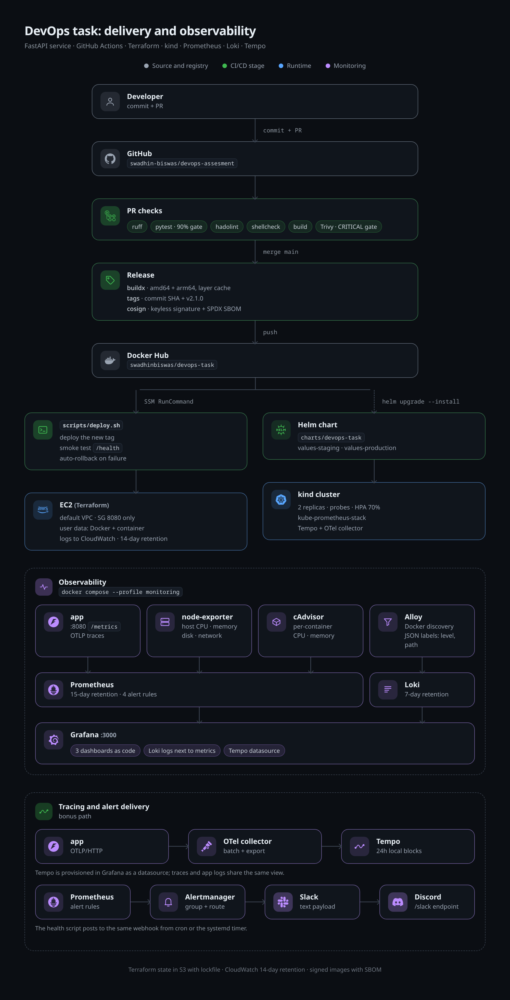
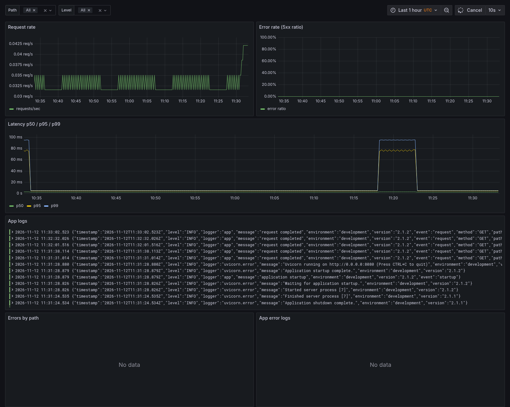
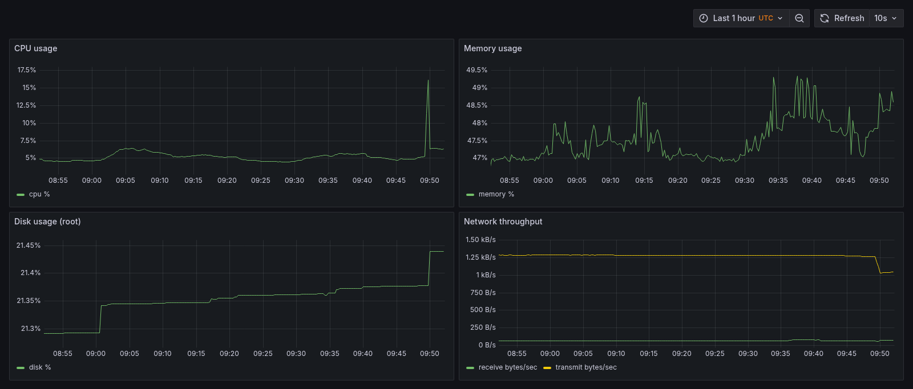
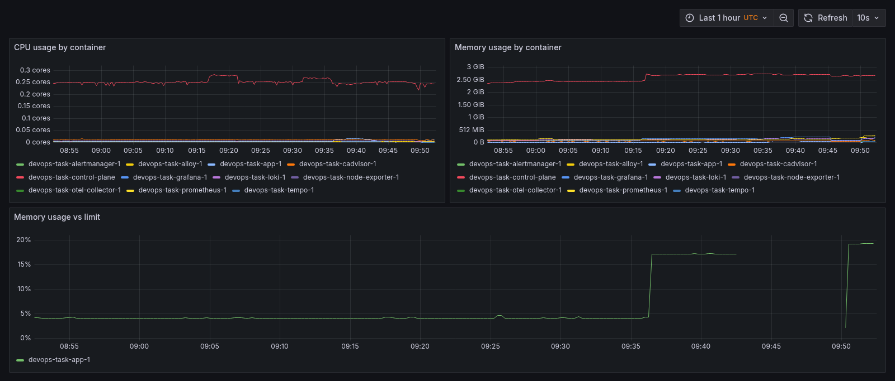
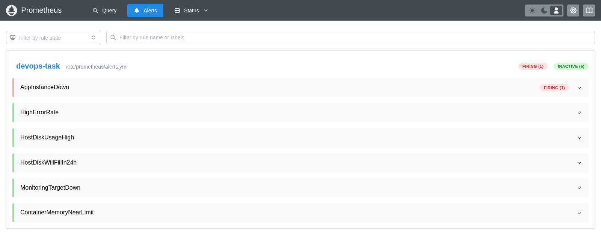

# DevOps task: FastAPI service, end to end

A small FastAPI service taken through the full assessment: hardened container, CI/CD with security gates, Terraform for AWS, Kubernetes manifests, a full Grafana/Prometheus/Loki stack, and a host health script. The bonus work is included too: Alertmanager routing, kube-prometheus-stack on Kubernetes, OpenTelemetry traces in Tempo, a Helm chart, keyless image signing with SBOMs, an Ansible hardening playbook, and webhook alerts from the health script.

[](https://github.com/swadhin-biswas/devops-assesment/actions/workflows/pr.yml)


All seven task steps are complete on `main`, and every bonus item is implemented. The final release is `v2.1.1`: a 24.5 MB image (the size CI reports), 17 tests covering 100% of the app code, signed and SBOM-attested, and deployed to both EC2 targets by the release workflow. Pushing a build change to `main` is all it takes. PR checks, build, sign, deploy, smoke test, and the GitHub Release run on their own. Every command below was run on my machine. The raw output lives in [`docs/evidence/`](docs/evidence/), and the key excerpts are inline.

## Contents

- [How this maps to the assessment](#how-this-maps-to-the-assessment)
- [Repository layout](#repository-layout)
- [Architecture](#architecture)
  - [How the diagram was made](#how-the-diagram-was-made)
- [Prerequisites](#prerequisites)
- [Quick start](#quick-start)
  - [1. Run the app](#1-run-the-app)
  - [2. Run the observability stack](#2-run-the-observability-stack)
  - [3. Run the tests](#3-run-the-tests)
  - [4. Run the health script](#4-run-the-health-script)
  - [5. Terraform](#5-terraform-ec2--cloudwatch--s3-state)
  - [6. Kubernetes](#6-kubernetes-kind)
- [Observability details](#observability-details)
- [Bonus features](#bonus-features)
- [CI/CD](#cicd)
- [Deployment & rollback strategy](#deployment--rollback-strategy)
- [Security considerations](#security-considerations)
- [Design decisions](#design-decisions)
- [AWS cost estimate](#aws-cost-estimate-production-ap-southeast-1-on-demand)
- [What I would improve with more time](#what-i-would-improve-with-more-time)
- [AI usage](#ai-usage)
- [Evidence](#evidence)
- [License](#license)

## How this maps to the assessment

| Step | What the task asks for | Where to look in this README | Raw evidence |
|---|---|---|---|
| 1 | Endpoints, env config, JSON logs, tests, Dockerfile, Compose | [Run the app](#1-run-the-app), [tests](#3-run-the-tests), [design decisions](#design-decisions) | [step1-app.md](docs/evidence/step1-app.md) |
| 2 | PR gates, release pipeline with rollback | [CI/CD](#cicd) | [step2-pr-checks.md](docs/evidence/step2-pr-checks.md), [step2-release.md](docs/evidence/step2-release.md), [step2-rollback.md](docs/evidence/step2-rollback.md) |
| 3 | EC2, IAM, user data, CloudWatch, remote state | [Terraform](#5-terraform-ec2--cloudwatch--s3-state) | [step3-terraform.md](docs/evidence/step3-terraform.md), [step3-security.md](docs/evidence/step3-security.md), [step3-cloudwatch-sample.txt](docs/evidence/step3-cloudwatch-sample.txt) |
| 4 | Deployment, Service, Ingress, HPA, rollout and undo | [Kubernetes](#6-kubernetes-kind) | [step4-k8s.md](docs/evidence/step4-k8s.md) |
| 5 | Six monitoring components, three dashboards, six alerts | [Observability stack](#2-run-the-observability-stack), [details](#observability-details) | [step5-observability.md](docs/evidence/step5-observability.md) |
| 6 | `system_health.sh` with thresholds, JSON, rotation, timer | [Health script](#4-run-the-health-script) | [step6-script.md](docs/evidence/step6-script.md) |
| Bonus | Alertmanager, K8s monitoring, tracing, Helm chart, signing, Ansible, webhook alerts | [Bonus features](#bonus-features) | [bonus.md](docs/evidence/bonus.md) |
| 7 | This README | every section | [`docs/evidence/`](docs/evidence/) |

## Repository layout

| Path | What it is |
|---|---|
| [`app/`](app/) | Application code: [`main.py`](app/main.py) (routes), [`config.py`](app/config.py), [`logging.py`](app/logging.py), [`metrics.py`](app/metrics.py), [`tracing.py`](app/tracing.py) |
| [`tests/`](tests/) | pytest suite (17 tests) |
| [`Dockerfile`](Dockerfile) | Multi-stage build: Python 3.12 Alpine, non-root UID 10001 |
| [`docker-compose.yml`](docker-compose.yml) | The app plus the `monitoring` profile |
| [`monitoring/prometheus/prometheus.yml`](monitoring/prometheus/prometheus.yml) | Scrape config; alert rules in [`alerts.yml`](monitoring/prometheus/alerts.yml) |
| [`monitoring/loki/loki-config.yml`](monitoring/loki/loki-config.yml) | Loki config, 168h retention |
| [`monitoring/alloy/config.alloy`](monitoring/alloy/config.alloy) | Docker container discovery and JSON log parsing |
| [`monitoring/grafana/`](monitoring/grafana/) | Provisioned datasources and the three dashboards: [`application`](monitoring/grafana/dashboards/application.json), [`host`](monitoring/grafana/dashboards/host.json), [`containers`](monitoring/grafana/dashboards/containers.json) |
| [`monitoring/alertmanager/`](monitoring/alertmanager/alertmanager.tmpl.yml) | Alertmanager config template and the env-substituting entrypoint |
| [`monitoring/tempo/`](monitoring/tempo/tempo-config.yml), [`monitoring/otel/`](monitoring/otel/config.yml) | Tempo storage config and the OTel collector pipeline |
| [`k8s/`](k8s/) | Plain manifests (Deployment, Service, Ingress, ConfigMap, HPA, [`secret.example.yaml`](k8s/secret.example.yaml)), [`k8s/monitoring/`](k8s/monitoring/kube-prometheus-stack-values.yaml) chart values, [`k8s/tracing/`](k8s/tracing/tempo.yaml) Tempo and collector |
| [`charts/devops-task/`](charts/devops-task/Chart.yaml) | Helm chart with [`staging`](charts/devops-task/values-staging.yaml) and [`production`](charts/devops-task/values-production.yaml) values |
| [`terraform/`](terraform/) | [`bootstrap/`](terraform/bootstrap/main.tf) (state bucket, OIDC role), shared [`modules/app-runtime/`](terraform/modules/app-runtime/main.tf), [`envs/staging/`](terraform/envs/staging/main.tf), [`envs/production/`](terraform/envs/production/main.tf) |
| [`scripts/system_health.sh`](scripts/system_health.sh) | Host health probe (task step 6) |
| [`scripts/systemd/system-health.timer`](scripts/systemd/system-health.timer) | Timer, with its [`service`](scripts/systemd/system-health.service), to run the probe every 5 minutes |
| [`scripts/deploy.sh`](scripts/deploy.sh) | EC2 deploy and rollback over SSM |
| [`scripts/apply-branch-protection.sh`](scripts/apply-branch-protection.sh) | One-time admin script for the `main` rules (PR, checks, squash, linear history) |
| [`ansible/`](ansible/playbook.yml) | Host hardening and health-probe deployment playbook |
| [`scripts/ci-check.sh`](scripts/ci-check.sh) | The CI checks, runnable locally |
| [`.github/workflows/pr.yml`](.github/workflows/pr.yml) and [`release.yml`](.github/workflows/release.yml) | PR gates and the release/deploy pipeline |
| [`.circleci/config.yml`](.circleci/config.yml), [`.buildkite/pipeline.yml`](.buildkite/pipeline.yml) | Fallback pipelines running the same checks |
| [`Makefile`](Makefile) | lint, test, build, diagram targets |
| [`VERSION`](VERSION) | Single release version used by the build and tags (2.1.1) |
| [`pyproject.toml`](pyproject.toml), [`uv.lock`](uv.lock) | Dependencies, locked |
| [`.env.example`](.env.example) | Template for `.env` (copy it, fill in the Grafana credentials) |
| [`docs/evidence/`](docs/evidence/) | Proof for each task step (table under Evidence) |
| [`docs/diagrams/`](docs/diagrams/architecture.html) | Self-contained HTML source for the architecture diagram |
| [`docs/images/`](docs/images/) | Architecture, dashboard and alert screenshots |

## Architecture



Source: [`docs/diagrams/architecture.html`](docs/diagrams/architecture.html).

The same image deploys two ways. On EC2, Terraform provisions the instance, SSM runs the deploy, and containers stream JSON logs to CloudWatch. On a local kind cluster, the plain manifests and the Helm chart do the same job.

Prometheus scrapes the app, node-exporter, and cAdvisor. Alloy ships parsed container logs to Loki. The OpenTelemetry collector forwards traces to Tempo. Alertmanager routes Prometheus alerts to Slack or Discord. Grafana reads all three data sources. The Kubernetes bonus path runs kube-prometheus-stack and Tempo with the app shipped by the chart.

### How the diagram was made

The diagram is a single self-contained HTML file with CSS layout and inline SVG icons: [`docs/diagrams/architecture.html`](docs/diagrams/architecture.html). I built the first draft with an AI assistant and corrected it against the repository.

The prompt described the real system and the constraints: the path from commit to PR checks to release to Docker Hub to SSM to two EC2 targets; the same image to kind and Helm; the monitoring plane (Prometheus, node-exporter, cAdvisor, Alloy, Loki, OTel collector, Tempo, Alertmanager, Grafana, Slack/Discord); a four-colour legend; a 1000 px width; and no external assets. The assistant returned the first HTML/CSS/SVG draft.

I checked every node and arrow against [`.github/workflows/pr.yml`](.github/workflows/pr.yml), [`.github/workflows/release.yml`](.github/workflows/release.yml), [`terraform/modules/app-runtime/main.tf`](terraform/modules/app-runtime/main.tf), [`k8s/`](k8s/), and [`monitoring/`](monitoring/), corrected the release tag to `v2.1.1`, and removed anything the repo does not actually run. The mapping is direct: PR checks come from `pr.yml`, Release from `release.yml`, Docker Hub from the push step in `release.yml`, EC2 and SSM from Terraform plus `scripts/deploy.sh`, kind and Helm from `k8s/` and `charts/`, and observability from `monitoring/`.

The source is rendered headlessly at 2x so the PNG stays sharp:

```bash
make diagram
# equivalent:
chromium --headless --no-sandbox --disable-gpu --hide-scrollbars \
  --force-device-scale-factor=2 --window-size=1000,1960 \
  --screenshot=docs/images/architecture.png \
  "file://$PWD/docs/diagrams/architecture.html"
```

Keeping the HTML in the repo means the diagram shows up in a diff and can be regenerated when the pipeline changes. The PNG is only the render. The AI helped with the layout and styling. Every box still points at a file in this repository, and the labels and arrows are the real delivery and monitoring paths.

## Prerequisites

| Tool | Needed for | Tested with |
|---|---|---|
| Docker + Compose v2 | app + observability stack | Docker 29, Compose 5.7 |
| [uv](https://docs.astral.sh/uv/) (Python 3.12) | tests, local app run | uv 0.9 |
| kind + kubectl | Kubernetes step | kind v0.30 |
| Terraform + AWS CLI | cloud steps | TF 1.14, AWS CLI 2 |
| Chromium (headless) | re-rendering the architecture diagram | Chromium 142 |

## Quick start

### 1. Run the app

```bash
cp .env.example .env          # APP_PORT/APP_ENV/LOG_LEVEL/APP_VERSION
docker compose up -d --build
curl -s http://127.0.0.1:8080/
curl -s http://127.0.0.1:8080/health
docker compose logs -f app    # JSON logs on stdout
```

`GET /` returns exactly `{"message":"Hello from DevOps Task!","status":"running","version":"2.1.1"}`.

From the running service:

```text
$ curl -s http://127.0.0.1:8080/
{"message":"Hello from DevOps Task!","status":"running","version":"2.1.1"}
$ curl -s http://127.0.0.1:8080/health
{"status":"ok","version":"2.1.1","environment":"development"}
```

The service reads every setting from the environment, logs one JSON object per line to stdout, and shuts down gracefully on SIGTERM. The same image with `APP_PORT=8090 APP_ENV=staging LOG_LEVEL=DEBUG` (timestamps trimmed):

```text
{"timestamp":"...","level":"INFO","logger":"app","message":"application startup","environment":"staging","version":"2.1.1","event":"startup"}
{"timestamp":"...","level":"INFO","logger":"app","message":"request completed","environment":"staging","version":"2.1.1","event":"request","method":"GET","path":"/health","status_code":200,"duration_ms":1.047}
{"timestamp":"...","level":"INFO","logger":"app","message":"application shutdown","environment":"staging","version":"2.1.1","event":"shutdown"}
{"timestamp":"...","level":"INFO","logger":"uvicorn.error","message":"Application shutdown complete.","environment":"staging","version":"2.1.1"}
```

SIGTERM was sent between the request and the shutdown lines. The process exited 143 (128 + 15).

The final image is 24.5 MB, the size the PR build reports. It runs as UID 10001 from a digest-pinned Python 3.12 Alpine base, with a HEALTHCHECK on `/health` and OCI labels. The Dockerfile and compose hardening are in [step1-app.md](docs/evidence/step1-app.md). Setting `OTEL_EXPORTER_OTLP_ENDPOINT` makes the same process export OTLP traces. See [Bonus features](#bonus-features).

### 2. Run the observability stack

```bash
# .env must contain GF_SECURITY_ADMIN_USER and GF_SECURITY_ADMIN_PASSWORD
docker compose --profile monitoring up -d
docker compose --profile monitoring ps
```

Open Grafana at `http://127.0.0.1:3000` and sign in with the `GF_SECURITY_ADMIN_*` values from `.env`. There is no external Grafana account. The admin user is created from `.env` on first start, and Compose refuses to start Grafana when the variables are missing. Data sources (Prometheus, Loki) and all three dashboards are provisioned from files under `monitoring/`, so nothing is set up by hand in the UI:

| Dashboard | Panels |
|---|---|
| Application (`devops-task-application`) | request rate, 5xx error ratio, latency p50/p95/p99, Loki log panel |
| Host (`devops-task-host`) | CPU, memory, disk, network (Node Exporter) |
| Containers (`devops-task-containers`) | per-container CPU, memory, memory vs limit (cAdvisor) |





Prometheus keeps 15 days (`--storage.tsdb.retention.time=15d`) and Loki keeps 7 days (`retention_period: 168h`). Only Grafana publishes a host port (127.0.0.1:3000). Everything else talks over the internal `monitoring` network. Grafana joins both networks because this Docker daemon does not publish ports for containers on an internal-only network.

Image versions are pinned. cAdvisor is `0.54.0` with `--docker_only=true`, the build that resolves container names on Docker 29 and containerd-snapshotter hosts (0.56.x panics there). With the profile running, the stack also includes Alertmanager, Tempo, and an OpenTelemetry collector.

Set `ALERT_WEBHOOK_URL` in `.env` to route alerts to Slack, or to `https://discord.com/api/webhooks/.../slack` for Discord. Without it, alerts stay in the Alertmanager UI. Tracing is opt-in: uncomment `OTEL_EXPORTER_OTLP_ENDPOINT=http://otel-collector:4318` in `.env` to export spans. Grafana has a provisioned Tempo datasource for traces. Alert rules, an error-spike walkthrough, the host-mount table, and the collection proof are in [Observability details](#observability-details).

### 3. Run the tests

```bash
uv sync --frozen
uv run pytest --cov=app --cov-report=term-missing   # 17 tests, 100% coverage
uv run ruff check .
make ci                                             # lint + tests + build + Trivy
```

Coverage from the suite:

```text
Name    Stmts   Miss Branch BrPart  Cover   Missing
---------------------------------------------------
TOTAL     145      0     20      0   100%

7 files skipped due to complete coverage.
17 passed in 0.60s
```

### 4. Run the health script

`scripts/system_health.sh` collects CPU, memory, and disk usage for all real mounted filesystems (pseudo filesystems excluded), the load average, and the top 5 processes by memory. It appends a timestamped entry to `health_log.txt`, or JSONL with `--json`. Warnings and criticals go to stderr. It exits `0` healthy, `1` warning, `2` critical, or `3` on a usage error.

```bash
./scripts/system_health.sh                       # one-shot, defaults: --disk 80 --cpu 90 --mem 85
./scripts/system_health.sh --json --disk 70      # JSONL entry, lower disk threshold
./scripts/system_health.sh --help                # all flags, defaults, cron example
```

Each exit path was exercised against the thresholds:

| Run | Command | Exit |
|---|---|---|
| Healthy | `./scripts/system_health.sh` | 0 |
| Warning | `./scripts/system_health.sh --disk 1` | 1 |
| Critical | `./scripts/system_health.sh --mem 0.5 --mem-critical 1` | 2 |
| Usage error | `./scripts/system_health.sh --bogus` | 3 |

`shellcheck -x scripts/system_health.sh` exits 0, and the same check runs in CI. Below are a healthy text entry and a JSON entry:

```text
[2026-11-11T17:25:15Z] healthy cpu=12.3% mem=44.4% load=1.26 cores=20 disks=/=20% /home=20% /var/log=20% /.snapshots=20% /var/cache/pacman/pkg=20% /boot=12% top_mem=qs(4244):3.7% chromium(370061):2.3% Telegram(590167):2.0% chromium(7992):1.9% zed-editor(22696):1.8%
```

```json
{"timestamp":"2026-11-11T17:25:16Z","status":"healthy","cpu_percent":11.7,"mem_percent":44.5,"load1":0.8,"cores":20,"disks":[{"mount":"/","percent":20},{"mount":"/home","percent":20},{"mount":"/var/log","percent":20},{"mount":"/.snapshots","percent":20},{"mount":"/var/cache/pacman/pkg","percent":20},{"mount":"/boot","percent":12}],"top_processes":[{"pid":4244,"name":"qs","percent_memory":3.7},{"pid":370061,"name":"chromium","percent_memory":2.3},{"pid":590167,"name":"Telegram","percent_memory":2.0},{"pid":7992,"name":"chromium","percent_memory":1.9},{"pid":22696,"name":"zed-editor","percent_memory":1.8}],"warnings":[],"criticals":[]}
```

Rotation was verified with `HEALTH_LOG_MAX_BYTES=250 HEALTH_LOG_KEEP=2` over six runs. The current file, `.1`, and `.2` exist, and the oldest is deleted (`.3` never appears). To run the probe every 5 minutes, install the systemd units from `scripts/systemd/`:

```bash
sudo cp scripts/system_health.sh /usr/local/bin/
sudo cp scripts/systemd/system-health.{service,timer} /etc/systemd/system/
sudo systemctl daemon-reload && sudo systemctl enable --now system-health.timer
```

A cron alternative (`*/5 * * * *`) is in `--help`. The timer is the monitoring integration point: exit 1 or 2 marks the unit failed for `systemctl --failed` or a watchdog.

### 5. Terraform (EC2 + CloudWatch + S3 state)

```bash
cd terraform/bootstrap           # S3 state bucket, GitHub OIDC role (local state)
cp terraform.tfvars.example terraform.tfvars
terraform init && terraform apply

cd ../envs/staging
cp backend.hcl.example backend.hcl
# set bucket to the value from: terraform -chdir=../bootstrap output -raw state_bucket
terraform init -backend-config=backend.hcl
terraform validate
terraform plan -var-file=staging.tfvars
terraform apply -var-file=staging.tfvars
curl -s http://$(terraform output -raw public_ip):8080/health
aws logs tail $(terraform output -raw log_group_name) --follow
terraform destroy -var-file=staging.tfvars   # after evidence is captured
```

Apply outputs and the destroy from the staging run:

```text
instance_id   = "i-0123456789abcdef0"
log_group_name = "/aws/ec2/devops-task/staging"
public_ip     = "198.51.100.20"

Destroy complete! Resources: 7 destroyed.
```

What the applied environment showed:

- Security group ingress: one rule, TCP 8080 from 0.0.0.0/0. No SSH, no other ports.
- Instance profile policy: `logs:CreateLogStream` and `logs:PutLogEvents` on the staging log group only, plus `AmazonSSMManagedInstanceCore` for the SSM deploy channel.
- `aws iam list-access-keys` for the local user returned `[]`; the instance has `"Key": null` (no key pair).
- Log group retention: 14 days. A real JSON log line from CloudWatch is in [step3-cloudwatch-sample.txt](docs/evidence/step3-cloudwatch-sample.txt).

Remote state, from `terraform/envs/staging/main.tf`:

```hcl
backend "s3" {}
```

The concrete values live in the gitignored `backend.hcl`, created from
[`terraform/envs/staging/backend.hcl.example`](terraform/envs/staging/backend.hcl.example): bucket, key, region, encryption and `use_lockfile = true`. `use_lockfile` is Terraform's S3-native locking, which is why `required_version` is `>= 1.10.0`.

There is no local state file. `ls terraform/envs/staging/*.tfstate` returns nothing and the state list is read through this backend. The bucket is the `state_bucket` output from `terraform/bootstrap`, so another account can initialize the same code without editing the backend block.

<details>
<summary>Terraform state (10 resources)</summary>

```text
module.runtime.data.aws_ami.ubuntu
module.runtime.data.aws_subnets.default
module.runtime.data.aws_vpc.default
module.runtime.aws_cloudwatch_log_group.app
module.runtime.aws_iam_instance_profile.instance
module.runtime.aws_iam_role.instance
module.runtime.aws_iam_role_policy.logs
module.runtime.aws_iam_role_policy_attachment.ssm
module.runtime.aws_instance.app
module.runtime.aws_security_group.app
```
</details>

`terraform/envs/staging` and `envs/production` share `terraform/modules/app-runtime`: EC2, a security group that opens only port 8080, a least-privilege IAM role, and a CloudWatch log group with 14-day staging retention and 30-day production retention. Each environment keeps its own S3-locked state.

The Terraform production stack is planned but not applied: `terraform -chdir=terraform/envs/production plan -var-file=production.tfvars`. The live production demo target was a second small instance bootstrapped with the same `app.env` and `deploy.sh` contract, so the release pipeline could prove a two-target rollout. Both demo targets were terminated after the final release, so a new deployment starts with `terraform apply` and fresh instance IDs in the repository variables. Production values use `t3.small`, 30-day log retention, and a restricted CIDR (replace the documentation range with your office/VPN range).

The instance boots from user data (Docker install, pull, run) and retries until IMDS credentials appear. It fetches `scripts/deploy.sh` from `main` and verifies its SHA-256. Set `deploy_script_ref` to a tag or commit and update `deploy_script_sha256` with the script for an immutable input. No SSH: SSM only, no key pair, no port 22.

If the account already has the GitHub OIDC provider, import it first:

```bash
terraform import aws_iam_openid_connect_provider.github \
  arn:aws:iam::<account-id>:oidc-provider/token.actions.githubusercontent.com
```

### 6. Kubernetes (kind)

```bash
kind create cluster --name devops-task
kubectl create secret generic devops-task-secret \
  --from-literal=APP_API_TOKEN=CHANGEME
kubectl apply -k k8s/
kubectl rollout status deployment/devops-task
kubectl get pods,svc,hpa
kubectl port-forward svc/devops-task 8080:80
curl -s localhost:8080/health
```

Only [`k8s/secret.example.yaml`](k8s/secret.example.yaml) is committed. The real Secret is created in the cluster. The app has no database password or API token, so `devops-task-secret` is the deployment-specific placeholder for such values. The one real secret in this submission is the Grafana admin password, stored in the `grafana-admin` Secret for the Kubernetes monitoring bonus.

The Deployment runs 2 replicas with `maxUnavailable: 0`, liveness, readiness, and startup probes on `/health`, requests `100m/64Mi`, limits `500m/256Mi`, UID 10001, a read-only root filesystem with a writable `/tmp` emptyDir, and all capabilities dropped. The HPA scales on CPU at 70%, from 2 to 5 replicas.

Zero-downtime update and rollback were proven with a 900-request loop against the Service (900/900 HTTP 200; `preStop: sleep 15` drains terminating pods), and again with a rollout to `v0.1.7` followed by `rollout undo`. The demo used the then-current `v0.1.7`/`v0.1.8` images. The manifest now pins `v2.1.1`, and the same flow applies:

```bash
kubectl set image deployment/devops-task app=swadhinbiswas/devops-task:v0.1.7
kubectl rollout status deployment/devops-task
kubectl rollout undo deployment/devops-task
kubectl rollout status deployment/devops-task
```

Output from this kind cluster:

```text
$ kubectl set image deployment/devops-task app=swadhinbiswas/devops-task:v0.1.7
deployment.apps/devops-task image updated
$ kubectl rollout status deployment/devops-task
Waiting for deployment "devops-task" rollout to finish: 0 out of 2 new replicas have been updated...
Waiting for deployment "devops-task" rollout to finish: 1 old replicas are pending termination...
deployment "devops-task" successfully rolled out
$ kubectl rollout undo deployment/devops-task
deployment.apps/devops-task rolled back
$ kubectl rollout status deployment/devops-task
Waiting for deployment "devops-task" rollout to finish: 1 out of 2 new replicas have been updated...
deployment "devops-task" successfully rolled out
```

HPA on the same cluster:

```text
NAME          REFERENCE                TARGETS       MINPODS   MAXPODS   REPLICAS   AGE
devops-task   Deployment/devops-task   cpu: 4%/70%   2         5         2          153m
```

`kind` does not ship metrics-server, so install it before relying on the HPA:

```bash
kubectl apply -f https://github.com/kubernetes-sigs/metrics-server/releases/latest/download/components.yaml
# On kind, add --kubelet-insecure-tls to the metrics-server deployment.
```

For EKS, the changes are: AWS Load Balancer Controller with ACM TLS instead of ingress-nginx, External Secrets Operator with Secrets Manager instead of a generated Secret, Karpenter or Cluster Autoscaler for nodes, IRSA or Pod Identity instead of instance roles, and managed Prometheus/Grafana or kube-prometheus-stack with remote storage.

## Observability details

### Collection proof

Prometheus targets, all `up`:

```text
app            up
node-exporter  up
cadvisor       up
```

The scrape config also monitors Prometheus, Loki, Alloy, and Alertmanager themselves. The three core targets above are the proof that app, host, and container metrics flow.

The rule file loads six alerts (`AppInstanceDown`, `HighErrorRate`, `HostDiskUsageHigh`, `HostDiskWillFillIn24h`, `ContainerMemoryNearLimit`, `MonitoringTargetDown`). The original four were inactive at capture time. Alloy parses the app's JSON logs and keeps the low-cardinality labels `level` and `path`. A Loki stream:

```text
labels: {'container': 'devops-task-app-1', 'detected_level': 'INFO', 'level': 'INFO', 'path': '/health', 'service': 'app', 'service_name': 'app'}
```

`AppInstanceDown` firing was verified by stopping the app for three minutes, then restarting it:



### Alert rules

Prometheus loads `monitoring/prometheus/alerts.yml`. The rule group evaluates every 30s; the global scrape and evaluation interval is 15s.

Every rule has a unit test in [`monitoring/prometheus/tests/alerts.test.yml`](monitoring/prometheus/tests/alerts.test.yml). `promtool test rules` runs in the `config-lint` job, so each rule has to fire on the series it claims to detect and stay quiet on clean traffic.

| Alert | Fires when | For | Why this threshold and duration |
|---|---|---|---|
| `AppInstanceDown` | `up{job="app"} == 0` | 2m | A scrape every 15s means two minutes covers a missed scrape and a short restart, so a normal redeploy does not page anyone. |
| `HighErrorRate` | `sum(rate(app_errors_total[5m])) / sum(rate(app_requests_total[5m])) > 0.05` | 5m | 5% over five minutes separates a real regression from a few bad requests; 4xx are client errors and excluded. |
| `HostDiskUsageHigh` | root filesystem used > 80% | 10m | 80% leaves room to act before writes fail, and ten minutes ignores brief build or cache spikes. |
| `ContainerMemoryNearLimit` | working set / limit > 90%, with limit > 0 | 5m | OOMKill is close once a container approaches its limit; five minutes avoids reacting to a single GC spike. The `limit > 0` filter prevents a false positive on unconstrained containers. |
| `HostDiskWillFillIn24h` | `predict_linear(avail[6h], 24h) < 0` | 1h | A static 80% threshold reacts late; six hours of slope gives roughly a day of warning before writes fail. |
| `MonitoringTargetDown` | `up{job=~"prometheus|loki|alloy|alertmanager"} == 0` | 5m | A silent monitoring plane means missing data, not a healthy system. Five minutes avoids a single scrape blip. |

`AppInstanceDown` and `HighErrorRate` are critical severity; the two resource alerts are warnings.

### Investigating an error spike

The Application dashboard holds the metrics and the app logs in one view, so the first pass happens without switching tools.

1. Read the error rate panel first. `Error rate (5xx ratio)` uses `sum(rate(app_errors_total[5m])) / sum(rate(app_requests_total[5m]))`; it tells you when the spike started and how large it is. If it stays above 5% for five minutes, `HighErrorRate` fires.
2. Compare with latency. If p95/p99 climbed with the errors, something got slow (a dependency or the event loop). If latency stayed flat, requests are failing fast, which usually means a bad deploy or a config error.
3. Open the `App logs` Loki panel on the same dashboard. The query is `{service="app"} | json`; narrow it to errors with `{service="app", level="ERROR"}`, then use the `path` label to separate one broken endpoint from a global failure.
4. Correlate with the Host and Containers dashboards. CPU saturation, disk pressure, or a container memory curve approaching its limit around the same timestamp points to resource pressure; a memory curve that hits the limit suggests an OOMKill.
5. Check whether Prometheus can scrape at all. If `AppInstanceDown` is firing and the logs stop, the process crashed or a deploy failed, which is a different investigation from a bad request path.
6. Close the loop after the fix: the error ratio should drop back under 5% and the `ERROR` log lines should stop.

### Host access for monitoring

| Container | Mounts | Why |
|---|---|---|
| Node Exporter | `/proc`, `/sys`, `/` read-only | Reads host CPU, memory, disk and network counters. Nothing is written. |
| cAdvisor | `/`, `/var/run`, `/sys`, `/var/lib/docker`, `/dev/disk` read-only | Reads cgroups and Docker metadata to attribute CPU and memory per container; `--docker_only=true` restricts it to Docker containers. `/var/run` includes the Docker socket, so this is a privileged interface even without `--privileged`. |
| Alloy | `/var/run/docker.sock` read-only | Docker service discovery finds containers and tails their logs. The filesystem mount is read-only, but the Docker API socket can still create or stop containers; production hardening is a read-only socket proxy in front of Alloy. |
| Grafana | no host mounts | Reads provisioned files and its own data volume. |

All host paths are mounted `:ro`. None of these containers runs `--privileged`, uses host networking, or adds capabilities.

A read-only mount does not make the Docker API read-only. The socket is still a privileged interface, which is why the production hardening step is a read-only socket proxy. The app container goes further: read-only root filesystem, all capabilities dropped, `no-new-privileges`.

## Bonus features

All seven bonus items are implemented. The raw output is in [bonus.md](docs/evidence/bonus.md).

### Where the webhook URLs live

No webhook URL is committed. Two variables cover both senders:

| Sender | Variable | Where to set it |
|---|---|---|
| Alertmanager (Compose) | `ALERT_WEBHOOK_URL` | `.env` in the repo root (copy `.env.example`). A Slack incoming webhook, or a Discord webhook ending in `/slack`. Compose passes it to the container and `monitoring/alertmanager/entrypoint.sh` renders it into the config. Unset means alerts stay in the Alertmanager UI. |
| Alertmanager (Kubernetes, optional) | the same URL, inside a Secret | The chart runs a no-op receiver by default. Create a Secret named `alertmanager-config` holding your rendered `alertmanager.yaml`, set `alertmanager.alertmanagerSpec.configSecret: alertmanager-config` in the values file, then `helm upgrade`. |
| `system_health.sh` from a shell or cron | `HEALTH_WEBHOOK_URL` | Export it before the script runs. Warning and critical results are posted; a failed delivery never changes the exit code. |
| `system_health.sh` from systemd | `HEALTH_WEBHOOK_URL` in `/etc/default/system-health` | `system-health.service` reads `EnvironmentFile=-/etc/default/system-health`; the Ansible playbook writes that file with mode 0600. |

Alertmanager sends a Slack-shaped payload, which is also what Discord expects at its `/slack` endpoint. The health script detects Discord from the URL and sends `{"content": ...}` instead of `{"text": ...}`.

### Alertmanager with Slack or Discord routing

Prometheus sends its six alerts to Alertmanager. The config template and the env-substituting entrypoint live in [`monitoring/alertmanager/`](monitoring/alertmanager/alertmanager.tmpl.yml). Add the webhook to `.env`:

```bash
ALERT_WEBHOOK_URL=https://hooks.slack.com/services/...   # or https://discord.com/api/webhooks/.../slack
docker compose --profile monitoring up -d alertmanager
```

Without the variable, Alertmanager starts with a no-op receiver and alerts stay in its UI. The template was validated with `amtool check-config`. A critical alert was delivered to a local sink using the real binary:

```json
{"attachments":[{"title":"FIRING HighErrorRate","text":"High 5xx error rate: More than 5% of requests returned 5xx\n","color":"danger"}]}
```

Discord accepts the same payload when the webhook URL ends in `/slack` (Discord's Slack-compatible endpoint), so one receiver covers both services.

### Monitoring on Kubernetes

```bash
helm repo add prometheus-community https://prometheus-community.github.io/helm-charts
kubectl create namespace monitoring
kubectl -n monitoring create secret generic grafana-admin \
  --from-literal=admin-user="$GF_SECURITY_ADMIN_USER" \
  --from-literal=admin-password="$GF_SECURITY_ADMIN_PASSWORD"
helm upgrade --install kube-prometheus-stack \
  prometheus-community/kube-prometheus-stack --version 93.2.0 \
  -n monitoring -f k8s/monitoring/kube-prometheus-stack-values.yaml
```

The release (chart `93.2.0`, app `v0.95.2`) runs Grafana, Prometheus, Alertmanager, node-exporter, kube-state-metrics, and the operator. Prometheus reports 14 targets, all up. kube-prometheus-stack ships its own Grafana dashboards. The three dashboards in `monitoring/grafana/dashboards` are provisioned in the Compose stack. A production Kubernetes deployment would add an app ServiceMonitor and PrometheusRule and import the same JSON. Grafana's admin credentials come from the Secret created above, never from a values file. Open it locally with:

```bash
kubectl -n monitoring port-forward svc/kube-prometheus-stack-grafana 3001:80
# http://127.0.0.1:3001, credentials from the grafana-admin Secret
```

### Distributed tracing with OpenTelemetry and Tempo

The app exports OTLP traces when `OTEL_EXPORTER_OTLP_ENDPOINT` is set ([`app/tracing.py`](app/tracing.py)). Compose adds `otel-collector` and `tempo`; Grafana has a provisioned Tempo datasource. Three real requests produced three traces:

```text
traces: 3
8827034c032b42c7222a55693fd206e1 devops-task-app GET /health
dae4d8daaea57f05cef291057b48bafa devops-task-app GET /health
456750ea5b7f6486b458fd79fd097050 devops-task-app GET /
```

One trace expanded to four spans (`GET /health` plus the three internal `http send` spans). The same pair runs in the cluster from [`k8s/tracing/`](k8s/tracing/tempo.yaml), and Grafana reports the Tempo datasource as working.

### Helm chart

```bash
helm lint charts/devops-task -f charts/devops-task/values-staging.yaml
helm upgrade --install devops-task charts/devops-task \
  -f charts/devops-task/values-staging.yaml --set image.tag=v2.1.1
```

[`values-staging.yaml`](charts/devops-task/values-staging.yaml) uses 2 replicas and an HPA from 2 to 5 at 70% CPU. [`values-production.yaml`](charts/devops-task/values-production.yaml) uses 3 replicas, an HPA from 3 to 10 at 60%, larger requests, and the ingress enabled.

The chart was installed over the plain manifests in kind. The release reported 2/2 ready and the HPA settled at `cpu: 3%/70%`. That test ran the then-current `v0.1.8` image. The chart now pins `v2.1.1`.

The chart defaults `existingSecret` to empty, so a fresh install works with the ConfigMap alone. Add `--set existingSecret=devops-task-secret` if you created the app Secret. If you are upgrading from earlier values that defaulted to `devops-task-secret`, set that value explicitly to keep the existing Secret overrides.

### Signed images and SBOM

The release workflow installs cosign and signs the pushed image digest keyless with the workflow's GitHub OIDC identity. It generates an SPDX SBOM with syft and attests the SBOM to the same digest. buildx also attaches SBOM and provenance attestations. Verify with:

```bash
cosign verify \
  --certificate-oidc-issuer https://token.actions.githubusercontent.com \
  --certificate-identity-regexp 'https://github.com/swadhin-biswas/devops-assesment/.github/workflows/release.yml@refs/heads/main' \
  swadhinbiswas/devops-task@sha256:<digest>

cosign verify-attestation --type spdxjson \
  --certificate-oidc-issuer https://token.actions.githubusercontent.com \
  --certificate-identity-regexp 'https://github.com/swadhin-biswas/devops-assesment/.github/workflows/release.yml@refs/heads/main' \
  swadhinbiswas/devops-task@sha256:<digest>
```

The v2.1.1 digest, signature verification, and the dual-instance deploy output are recorded in [bonus.md](docs/evidence/bonus.md).

### Health script webhook alerts

`HEALTH_WEBHOOK_URL` makes `system_health.sh` POST warning and critical results; healthy runs send nothing, and a failed delivery never changes the exit code:

```bash
HEALTH_WEBHOOK_URL=https://discord.com/api/webhooks/... ./scripts/system_health.sh --disk 1
```

Slack receives `{"text": ...}`; Discord receives `{"content": ...}`. A failed POST prints `[WARNING] webhook delivery failed` and the script still exits with the real status.

### Ansible hardening playbook

```bash
cd ansible
cp inventory.example.ini inventory.ini   # edit hosts and user
ansible-galaxy collection install community.general
ansible-playbook -i inventory.ini playbook.yml -e health_webhook_url="$HEALTH_WEBHOOK_URL"
```

The playbook applies safe upgrades, installs the probe and timer, writes the webhook into `/etc/default/system-health` (mode 0600), disables root and password SSH logins, applies sysctl hardening, and enables UFW with only 22 and 8080 open. `ansible-playbook --syntax-check` passes, and the task list is in the evidence file.

It targets a generic Ubuntu/Debian host with SSH access. The Terraform EC2 path is SSM-only and has no SSH key and no port 22, so applying this playbook there would mean adding both. UFW also does not filter Docker-published ports, so the security group stays the boundary for the app port.

## CI/CD

Pull requests run a version-consistency check, a bump guard for build inputs, ruff, pytest with a 90% coverage gate and a job-summary report, hadolint, shellcheck, an image build, a SHA-256-verified Trivy scan that fails on CRITICAL findings, and a config-lint job (Prometheus rules, Alertmanager config, Helm, kubeconform, actionlint). GitHub secret scanning covers the public repository.

| Job | Result | Covers |
|---|---|---|
| `lint-and-test` | pass | version consistency, VERSION-bump guard, ruff, pytest with a 90% gate, coverage summary, deploy rollback test |
| `lint-containers` | pass | hadolint on the Dockerfile, shellcheck on `scripts/` and the Alertmanager entrypoint |
| `image-scan` | pass | image build, SHA-256-verified Trivy with `severity: CRITICAL`, `exit-code: 1` |
| `config-lint` | pass | `promtool` rules and rule unit tests, `amtool` config, Helm lint, kubeconform, actionlint |

From PR run [43183003082](https://github.com/swadhin-biswas/devops-assesment/actions/runs/43183003082):

```text
TOTAL     145      0     20      0   100%
============================== 17 passed in 0.97s ==============================
deploy rollback test passed
```

The Trivy gate itself was proven on run 43019232745: `python:3.8-slim` reported 9 CRITICAL findings and the step exited 1.

Every push to `main` runs the `PR checks` workflow. When it succeeds, the release workflow starts automatically via `workflow_run`, reads [VERSION](VERSION), and builds `linux/amd64` and `linux/arm64` images with GitHub Actions layer caching. A prepare job diffs the commit against its parent and skips changes that do not touch `app/`, the Dockerfile, dependencies, `scripts/deploy.sh`, the release workflow, or `VERSION`, so docs-only merges do not release. The PR check refuses a build change that does not bump `VERSION`, so the immutable version tag is always new.

Images are tagged with `v<VERSION>` (currently `v2.1.1`) and the full commit SHA. `latest` is never used. Deployments use the immutable SHA tag.

The release preflight is idempotent. If `v<VERSION>` does not exist it builds, signs, and attests. If it already points at the same commit it reuses that signed image and deploys it. If it points at a different commit it refuses, so a version tag is never reassigned and a rollback always names the exact image that ran. Duplicate `workflow_run` events, re-runs, and manual dispatches are safe instead of failing on an already-pushed tag.

The release logs in to Docker Hub, pushes, syncs `scripts/deploy.sh` over SSM, deploys to both staging and production, and smoke tests `/health` with a version assertion on each instance. If the deploy or smoke test fails, `scripts/deploy.sh --rollback` restores the previous image tag. The same job signs the image digest keyless with cosign, generates an SPDX SBOM with syft, and attests the SBOM to that digest. It also creates the GitHub Release for the tag, so there is no manual post-release step. See [Signed images and SBOM](#signed-images-and-sbom).

From the historical v0.1.7 release run [43041045214](https://github.com/swadhinbiswas/devops-assesment/actions/runs/43041045214) on the original repository; the current v2.1.1 release and digest are in [bonus.md](docs/evidence/bonus.md):

```text
Cache restored successfully
"image.name": "swadhinbiswas/devops-task:v0.1.7,swadhinbiswas/devops-task:e61267a83954aa16d735606a1e90a320d13b34ae"
SSM command: 13d3e714-305d-4dc9-a541-093f92f9b565
2026-11-11T14:47:14Z healthy: 0.1.7
```

The registry serves one OCI index with both platforms:

```text
mediaType: application/vnd.oci.image.index.v1+json
platform: linux/amd64 digest: sha256:b13eb8ec9023d... size: 1242 bytes
platform: linux/arm64 digest: sha256:a2b2a988bb50a... size: 1242 bytes
```

The two `unknown/unknown` entries in that index are the SBOM and provenance attestations attached by buildx.

The failed-deploy rollback was proven live with a deliberately bogus tag (`hello-world:9.9.9-bogus`):

```text
rolling back to swadhinbiswas/devops-task:v0.1.8 (0.1.8)
rollback healthy: swadhinbiswas/devops-task:v0.1.8 (0.1.8)
```

Full transcript in [step2-rollback.md](docs/evidence/step2-rollback.md).

Repository configuration (in GitHub under Settings → Secrets and variables → Actions):

| Type | Name | Purpose |
|---|---|---|
| Variable | `AWS_REGION` | `ap-southeast-1` |
| Variable | `AWS_ROLE_ARN` | OIDC deploy role from `terraform output` |
| Variable | `DOCKERHUB_USERNAME` | Docker Hub account |
| Variable | `EC2_INSTANCE_ID_STAGING` | staging target (`i-...`) |
| Variable | `EC2_INSTANCE_ID_PROD` | production target (`i-...`) |
| Variable | `EC2_INSTANCE_ID` | optional single-target fallback; deduplicated if it repeats a target |
| Secret | `DOCKER_HUB_KEY` | Docker Hub token (Read & Write) |

No AWS access keys exist anywhere. AWS calls assume the deploy role through GitHub OIDC. The instance pulls the public image anonymously, so no registry credential sits on the host either.

The two instance variables still hold the demo targets that were terminated after the final release. Point them at new instances after `terraform apply` and the next release deploys to them.

### Fallback checks

GitHub Actions is the only pipeline. Every job runs on GitHub-hosted `ubuntu-latest` runners, which have Docker and QEMU. There are no self-hosted runners. The same checks run locally with `make ci` or `./scripts/ci-check.sh --no-docker`.

`.circleci/config.yml` mirrors the PR job for CircleCI. Buildkite's GitHub integration imports `.github/workflows/pr.yml` and reports those jobs as Buildkite checks, and the repo keeps a native `.buildkite/pipeline.yml` fallback. Fork pull requests are skipped, so untrusted code never runs with repository credentials.

### Optional CI mirrors

`.circleci/config.yml` and `.buildkite/pipeline.yml` run the same PR checks on CircleCI and Buildkite. Neither is part of the release path: GitHub Actions is the only release owner, and the mirrors have no release step. The Buildkite importer needed one change, because `aquasecurity/trivy-action` checks out its own tooling and the importer only supports the event repository:

```text
checkout adapter: explicit input "repository" value is unsupported
```

The scan now installs a pinned Trivy release and runs the CLI, which works in both. The details are in [buildkite.md](docs/evidence/buildkite.md).

### Repository rules for `main`

`main` is protected. The rules are applied with the admin script, so another repository can reproduce them:

```bash
gh auth login   # account with admin on the target repo
./scripts/apply-branch-protection.sh swadhin-biswas/devops-assesment
```

The live rules are:

- Pull requests required; the branch must be up to date and history must be linear.
- Required checks: `lint-and-test`, `lint-containers`, `image-scan`, `config-lint`.
- Direct pushes, force pushes, and branch deletion blocked; conversations must be resolved.
- Squash merges only; merged branches are deleted automatically, and auto-merge is available.
- GitHub Actions workflow tokens default to read-only.
- Secret scanning with push protection is enabled by GitHub for public repositories; enable Dependabot alerts and security updates in Settings → Code security.
- CI runs on GitHub-hosted `ubuntu-latest` runners, so hadolint, image builds, and Trivy always have Docker available.

## Deployment & rollback strategy

1. Build once, promote by tag. `main` merges produce exactly one multi-arch image, tagged with the commit SHA and `v<VERSION>` (currently `v2.1.1`). Deployments use the SHA tag; the version tag is an immutable release alias. Environments never build their own image, so what CI tested is what runs.
2. Deploy atomically. The release job sends `scripts/deploy.sh <tag>` over SSM. The script records the currently running tag, pulls the new one, swaps the container, and waits for `/health` to answer.
3. Smoke before calling it done. `/health` must return 200 within the smoke window; anything else is a failed deploy.
4. Roll back automatically. On any deploy or smoke failure the script redeploys the previous tag (the `--rollback` path) and exits non-zero so the workflow fails visibly. This is the path proven by the bogus-tag run above.
5. On Kubernetes, `kubectl set image` plus `rollout status`, with `maxUnavailable: 0` so capacity never drops; `kubectl rollout undo` returns to the previous ReplicaSet revision (demonstrated, 900/900).
6. The service is stateless (no database schema), so image-level rollback is complete and there is no data migration to undo.
7. The EC2 path is a single-instance swap (`docker rm -f` then `docker run`), so it has a brief restart window; zero-downtime is demonstrated on Kubernetes. A production HA path would use two instances behind an ALB.

## Security considerations

- Secrets management: no secrets in the repo or CI logs. AWS access uses GitHub OIDC (no static keys), the Docker Hub token lives only in the Actions secret store, Grafana credentials come from `.env` (gitignored, with a fail-closed entrypoint), and the Kubernetes Secret is created at apply time (only an example file is committed). Alertmanager and the health script read their webhook URLs from environment variables. GitHub secret scanning and push protection cover every push to the public repository.
- Image supply chain: both base images are pinned by digest (`@sha256:...`), and CI fails the build on Trivy CRITICAL findings; hadolint gates Dockerfile hygiene. Release images are signed keyless with the workflow's GitHub OIDC identity, and the SPDX SBOM is attested to the same digest, so there is no long-lived signing key to leak.
- IAM: the GitHub Actions deploy role is trusted only for this repo and `main`; the EC2 instance profile is scoped to CloudWatch Logs write and SSM Session Manager; the app pulls the public Docker Hub image anonymously. No static access keys anywhere, no SSH key pair on the instance (SSM Session Manager only).
- Network exposure: the security group opens only 8080, the app binds 127.0.0.1 locally, and in the monitoring stack only Grafana is published (on loopback) while everything else stays on the internal Docker network.
- Runtime hardening: the application container runs as UID 10001 with a read-only root filesystem, all capabilities dropped, `no-new-privileges`, and resource limits; the Kubernetes `securityContext` mirrors this. cAdvisor and Node Exporter mount host paths read-only only (see the host access table above).

## Design decisions

| Decision | Choice | Why |
|---|---|---|
| Final image | Python 3.12 Alpine, pinned by digest; shell + `apk` removed | The runtime matches the builder ABI; exact Alpine package pins were removed after Alpine moved to Python 3.14 and libstdc++/libgcc 15.2.0-r5, which made clean builds unsatisfiable. Distroless would drop the shell entirely; Alpine keeps the runtime small and supports the Python `HEALTHCHECK`. |
| Compute | EC2 + SSM over ECS/EKS | One stateless service: EC2 is the cheapest production-ready target, ECS adds scheduling value only at multi-service scale, EKS costs ~$73/mo control plane before nodes. K8s competency is demonstrated on kind without paying for it. |
| Registry | Docker Hub (public) | The EC2 instance pulls anonymously, so no registry credentials sit on the host and the deploy path needs no ECR login. No ECR resources are provisioned; Docker Hub is the only registry. |
| Tagging | SHA + `v<VERSION>` (currently 2.1.1), never `latest` | Deploys and rollbacks use the full SHA; the semver tag is an immutable release alias that the workflow refuses to reuse, so a rollback always names the exact image. |
| Deploy channel | SSM Run Command | No inbound SSH surface, no key management; the GitHub OIDC deploy role allows `ssm:SendCommand` scoped to instances in this account, and the instance role runs the SSM agent. |
| Kubernetes deploys | Plain manifests plus a Helm chart | The task asks for manifests, so `k8s/` stays readable and standalone; the chart packages the same resources with staging and production values for repeatable releases. |
| Kubernetes monitoring | kube-prometheus-stack | One chart brings the operator, Prometheus, Alertmanager, Grafana, kube-state-metrics and node-exporter with CRDs; values stay kind-sized with 6h retention and the control-plane scrapers off. |
| Tracing | OTel SDK, collector, Tempo | Vendor-neutral instrumentation in the app, a collector that can fan out later, and a Grafana-native backend. Tempo keeps 24h locally; production would use object storage. |
| Image signing | cosign keyless | No signing key to store or rotate; the certificate binds to the GitHub workflow identity. The SBOM is generated with syft and attested to the same digest. |
| Host management | Ansible | Repeatable hardening and probe rollout over SSH; a validation task checks the complete sshd config before the restart handler, and sysctl reloads only on change. |
| Log labels | `level` + `path` only | Both are low-cardinality: a few levels, bounded route templates. Request IDs and raw URLs stay in the line body; indexing them would explode Loki's stream count with traffic. |
| Prometheus retention | 15d | Local filesystem store; 15 days is enough to see weekly patterns without unbounded disk growth. Loki: 7d. |
| Alert thresholds | See Alert rules above | Each `for` duration tolerates transient spikes; the table explains every value. |

## AWS cost estimate (production, ap-southeast-1, on-demand)

| Item | Spec | Monthly |
|---|---|---|
| EC2 t3.micro | 2 vCPU / 1 GB, 24/7 | ~$8.50 |
| EBS gp3 root volume | 20 GB | ~$1.60 |
| Public IPv4 | 1 address, 24/7 | ~$3.65 |
| CloudWatch Logs | ~1 GB ingest, 14-day retention | ~$0.70 |
| S3 (Terraform state + versions) | < 1 GB | ~$0.05 |
| Data transfer out | few GB (image pulls are inbound/free) | ~$0.25 |
| **Total** | single instance | **~$15/month** |

The table excludes optional EBS snapshots (about $1/month for 20 GB). Terraform
does not create a snapshot schedule. A t3.small (2 GB) gives the app headroom: about
$15.2 plus storage and the IPv4 address, call it $21/month.

The EKS path would add a ~$73 control plane and two t3.small nodes (~$30), so $103+/month
before load balancers. That is why EC2 was chosen for this scope. The bonus monitoring
stack runs on the local kind cluster and adds no AWS cost. Managed Prometheus and
Grafana on EKS would add roughly $50 to $100/month depending on retention and storage.

## What I would improve with more time

- Per-team routing: Alertmanager now delivers to one webhook; add separate receivers per team, silences, and dedup, and point the Kubernetes Alertmanager at the same secret.
- Staging environment in CI: deploy to a staging instance on PR merge, run an integration smoke suite, then promote the same tag to production.
- SLO burn-rate alerts on top of the static thresholds, with multi-window paging instead of single-metric trips.
- Loki on object storage (S3 backend) so retention and restarts don't depend on one node's disk.
- E2E tests (testcontainers) and a k6 load profile in CI, to catch latency regressions the unit tests can't.
- Dependency automation: Renovate for base images and Python dependencies, with a Trivy re-scan per bump.
- HA for the EC2 path: two instances behind an ALB in an ASG, or ECS with blue/green deploys.
- Front the Docker socket with a read-only socket proxy and narrow cAdvisor's host mounts; the current read-only mounts still expose a privileged API to those containers.
- Add `trace_id`/`span_id` to the JSON logs and a Loki derived field to Tempo; tracing is provisioned, but logs and traces are not yet correlated.
- Add a fault-injection endpoint behind an environment flag and capture a real `HighErrorRate` firing; the rule is validated by `promtool` and `AppInstanceDown` has a firing screenshot, but the error-rate alert has not been fired in this evidence.
- Refresh and scan the monitoring images with the app image; they are pinned to versions that work with this Docker/kind setup but are not the newest releases.
- Add TLS/ALB and restrict the EC2 egress path for production; the demo is a single HTTP instance with broad egress for image pulls and SSM.
- Add CloudWatch alarms for the EC2 host and a snapshot schedule; the current cost table excludes snapshots because Terraform does not create them.
- Add `org.opencontainers.image.source` and `.url` labels in a future image build; the current OCI labels cover title, description, version, revision, created time, and license.
- Containerd-native container metrics: this workstation runs Docker 29's containerd snapshotter; cAdvisor 0.54 works, but a containerd-native exporter would age better.

## AI usage

AI tools helped with the scaffolding, with the PromQL and LogQL queries, with debugging, and with the HTML/CSS/SVG for the architecture diagram. Four examples: removing a deprecated Loki config field, pinning cAdvisor to 0.54.0 for Docker 29, fixing a `/proc/stat` parsing bug in `system_health.sh` that made every run report 100% CPU, and turning the architecture description into the reviewable HTML source in [`docs/diagrams/architecture.html`](docs/diagrams/architecture.html).

I reviewed and ran everything myself. The evidence files hold real output from my machine, and I can explain any part of this submission.

## Evidence

Workflow runs: [PR checks 43183003082](https://github.com/swadhin-biswas/devops-assesment/actions/runs/43183003082), [Release 43183073779](https://github.com/swadhin-biswas/devops-assesment/actions/runs/43183073779) (v2.1.1, both EC2 targets), and the [v2.1.1 GitHub Release](https://github.com/swadhin-biswas/devops-assesment/releases/tag/v2.1.1). Earlier runs are linked in the evidence files.

Task-step proof, captured from real runs (all files in [`docs/evidence/`](docs/evidence/)):

| Task step | File | What it proves |
|---|---|---|
| 1 | [`step1-app.md`](docs/evidence/step1-app.md) | Endpoints, metrics, JSON logs, SIGTERM shutdown, tests, image and compose facts |
| 2 | [`step2-pr-checks.md`](docs/evidence/step2-pr-checks.md) | Lint, tests, coverage, hadolint, shellcheck, build, Trivy gate |
| 2 | [`step2-release.md`](docs/evidence/step2-release.md) | SHA + semver tags, cache hit, multi-arch manifest, deploy smoke result |
| 2 | [`step2-rollback.md`](docs/evidence/step2-rollback.md) | Failed deploy rolls back, previous version restored |
| 2 | [`buildkite.md`](docs/evidence/buildkite.md) | Buildkite importer diagnosis and the Trivy CLI fix |
| 3 | [`step3-terraform.md`](docs/evidence/step3-terraform.md) | Clean plan, apply outputs, state list, destroy, S3 backend with lockfile |
| 3 | [`step3-security.md`](docs/evidence/step3-security.md) | SG 8080-only, scoped IAM, no static keys, no key pair |
| 3 | [`step3-cloudwatch-sample.txt`](docs/evidence/step3-cloudwatch-sample.txt) | JSON app logs in CloudWatch, 14-day retention |
| 4 | [`step4-k8s.md`](docs/evidence/step4-k8s.md) | Rolling update 900/900, HPA metrics, rollout undo output |
| 5 | [`step5-observability.md`](docs/evidence/step5-observability.md) | Prometheus targets, alert rules, firing proof, Loki parsed labels |
| 6 | [`step6-script.md`](docs/evidence/step6-script.md) | Shellcheck clean, exit codes, JSON, rotation, scheduling units |
| Bonus | [`bonus.md`](docs/evidence/bonus.md) | Alertmanager routing, kube-prometheus-stack, traces, Helm chart, webhooks, Ansible, signing |

Screenshots live in [`docs/images/`](docs/images/): `application-dashboard.png`, `host-dashboard.png`, `containers-dashboard.png`, and `alert-firing.png` (AppInstanceDown firing after the app was stopped for 3 minutes, then restored). The screenshots were captured before the final unit, variable, and error-panel additions; the JSON files under `monitoring/grafana/dashboards/` are the source of truth.

All AWS compute was destroyed after testing, as the task asked. The Terraform staging stack, the two demo instances the release deployed to, their security groups and the instance profile are gone. The destroy output is in [step3-terraform.md](docs/evidence/step3-terraform.md).

What remains is the pipeline and the evidence: the Docker Hub image, the OIDC deploy role, the S3 bucket with the Terraform state, the CloudWatch log groups that recorded the container output, and these files.

## License

MIT
